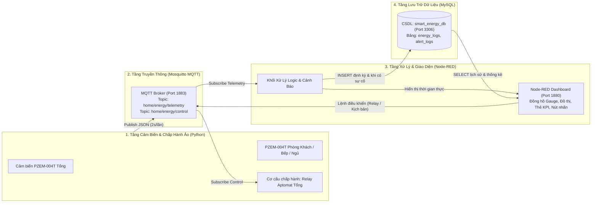
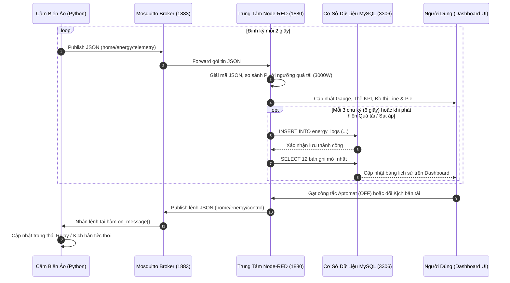
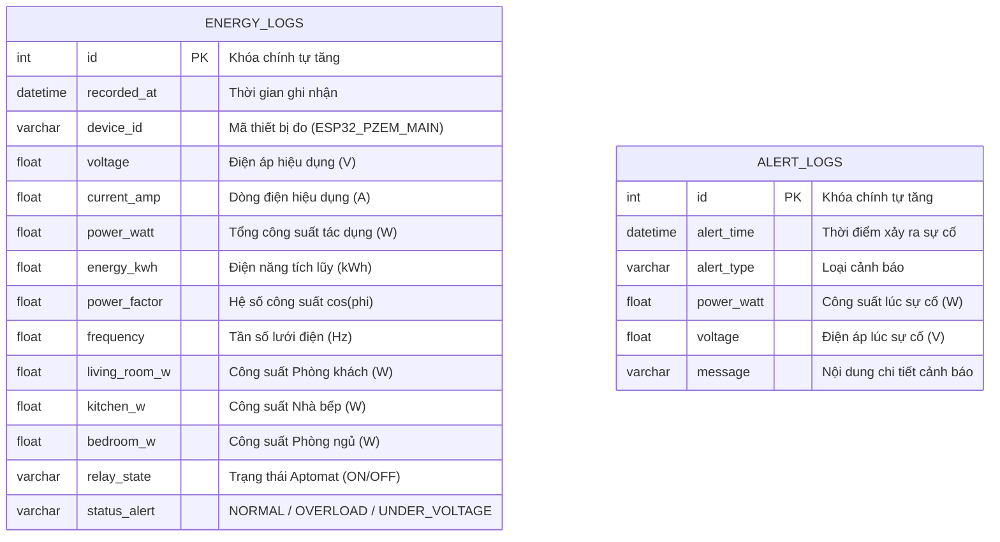

# CHƯƠNG 4: THIẾT KẾ, XÂY DỰNG VÀ MÔ PHỎNG HỆ THỐNG

---

## 4.1. Tổng quan kiến trúc hệ thống mô phỏng

Trong bối cảnh nghiên cứu và phát triển các hệ thống Internet vạn vật (IoT) phục vụ nhà thông minh (Smart Home), việc xây dựng mô hình mô phỏng toàn diện bằng phần mềm trước khi triển khai phần cứng thực tế đóng vai trò quan trọng. Phương pháp này cho phép kiểm chứng tính đúng đắn của giao thức truyền thông, lưu đồ xử lý dữ liệu, khả năng chịu tải của cơ sở dữ liệu cũng như tính trực quan của giao diện giám sát trong các tình huống sự cố điện lưới (quá tải, sụt áp, mất pha) mà không gây nguy hiểm cho người thử nghiệm.

Hệ thống **IoT Giám sát và Điều khiển Điện năng Tiêu thụ trong Gia đình** được thiết kế theo kiến trúc 4 tầng tiêu chuẩn, kết hợp giữa **Python**, **Mosquitto MQTT Broker**, **Node-RED** và hệ quản trị cơ sở dữ liệu **MySQL**.



### Chức năng của từng thành phần trong kiến trúc:
1. **Khối thiết bị IoT giả lập ([sensor_simulator.py](file:///C:/Users/Trung/.gemini/antigravity/scratch/iot-energy-monitor/simulator/sensor_simulator.py)):** Đóng vai trò tương đương vi điều khiển **ESP32** giao tiếp với các module đo điện xoay chiều 1 pha **PZEM-004T v3.0** và module **Relay đóng cắt tải**. Chương trình sinh dữ liệu điện năng sát với đặc tính vật lý thực tế và phản hồi tức thời với các lệnh điều khiển từ xa.
2. **Trạm trung chuyển tin nhắn ([mosquitto.conf](file:///C:/Users/Trung/.gemini/antigravity/scratch/iot-energy-monitor/mosquitto/mosquitto.conf) / [mqtt_broker.js](file:///C:/Users/Trung/.gemini/antigravity/scratch/iot-energy-monitor/services/mqtt_broker.js)):** Hoạt động trên cổng TCP `1883` theo mô hình Publish/Subscribe, đảm bảo truyền nhận gói tin hai chiều với độ trễ thấp và băng thông tối ưu.
3. **Phần mềm điều khiển trung tâm ([flows.json](file:///C:/Users/Trung/.gemini/antigravity/scratch/iot-energy-monitor/nodered_data/flows.json)):** Sử dụng nền tảng **Node-RED** để phân tích gói tin JSON, kiểm tra ngưỡng an toàn (quá tải, thấp áp, quá áp), hiển thị dữ liệu trực tuyến trên **Node-RED Dashboard** và điều phối việc đọc/ghi cơ sở dữ liệu.
4. **Hệ quản trị cơ sở dữ liệu ([schema.sql](file:///C:/Users/Trung/.gemini/antigravity/scratch/iot-energy-monitor/database/schema.sql) / [mysql_server.py](file:///C:/Users/Trung/.gemini/antigravity/scratch/iot-energy-monitor/services/mysql_server.py)):** Lưu trữ lịch sử các thông số điện năng trên cổng `3306`, phục vụ truy vấn dữ liệu quá khứ và thống kê phụ tải đỉnh ($P_{\max}$).

---

## 4.2. Mô hình toán học và thuật toán giả lập cảm biến điện năng (Python)

Để dữ liệu mô phỏng phản ánh chính xác quy luật vật lý của lưới điện xoay chiều 1 pha sinh hoạt tại Việt Nam ($220\text{V} - 50\text{Hz}$), chương trình giả lập trong [sensor_simulator.py](file:///C:/Users/Trung/.gemini/antigravity/scratch/iot-energy-monitor/simulator/sensor_simulator.py) được xây dựng dựa trên các phương trình điện kỹ thuật sau:

### 4.2.1. Tính toán các đại lượng điện cơ bản

Tổng công suất tác dụng của hộ gia đình ($P_{\text{total}}$, đơn vị $\text{W}$) tại thời điểm $t$ bằng tổng công suất tiêu thụ của 3 khu vực nhánh (Phòng khách, Nhà bếp, Phòng ngủ):

$$P_{\text{total}}(t) = P_{\text{living}}(t) + P_{\text{kitchen}}(t) + P_{\text{bedroom}}(t)$$

Khi Aptomat tổng ở trạng thái đóng (`relay = ON`), dòng điện hiệu dụng tổng chạy qua công tơ ($I$, đơn vị $\text{A}$) được xác định từ công suất tác dụng $P_{\text{total}}$, điện áp lưới hiệu dụng $U$ ($\text{V}$) và hệ số công suất $\cos\phi$:

$$I(t) = \frac{P_{\text{total}}(t)}{U(t) \cdot \cos\phi(t)}$$

Ngược lại, khi Aptomat tổng bị ngắt từ xa (`relay = OFF`), dòng điện và công suất tiêu thụ tại mọi nhánh lập tức giảm về $0$ ($I = 0\text{A}, P_{\text{total}} = 0\text{W}$), trong khi cảm biến đầu nguồn vẫn đo được điện áp lưới $U(t)$ và tần số $f(t)$.

Điện năng tiêu thụ tích lũy ($E$, đơn vị $\text{kWh}$) được cộng dồn liên tục theo chu kỳ lấy mẫu $\Delta t$ (giây):

$$E(t) = E(t - \Delta t) + \frac{P_{\text{total}}(t)}{1000} \cdot \frac{\Delta t}{3600} \cdot k_{\text{sim}}$$

*(Trong đó $k_{\text{sim}} = 30$ là hệ số gia tốc thời gian mô phỏng giúp quan sát rõ sự biến thiên của chỉ số công tơ và chi phí tiền điện trong quá trình chạy thử nghiệm).*

### 4.2.2. Thuật toán tính tiền điện theo biểu giá bậc thang EVN

Hệ thống tích hợp hàm [`calculate_evn_bill`](file:///C:/Users/Trung/.gemini/antigravity/scratch/iot-energy-monitor/simulator/sensor_simulator.py#L29-L49) để tính toán chi phí tiền điện lũy tiến theo 6 bậc thang tiêu chuẩn của Tập đoàn Điện lực Việt Nam (EVN), sau đó cộng thêm $8\%$ thuế giá trị gia tăng (VAT):

| Bậc thang | Định mức tiêu thụ ($\text{kWh}$) | Đơn giá chưa VAT ($\text{VNĐ/kWh}$) |
| :--- | :--- | :--- |
| **Bậc 1** | Cho $\text{kWh}$ từ $0 - 50$ | $1.806$ |
| **Bậc 2** | Cho $\text{kWh}$ từ $51 - 100$ | $1.866$ |
| **Bậc 3** | Cho $\text{kWh}$ từ $101 - 200$ | $2.167$ |
| **Bậc 4** | Cho $\text{kWh}$ từ $201 - 300$ | $2.729$ |
| **Bậc 5** | Cho $\text{kWh}$ từ $301 - 400$ | $3.050$ |
| **Bậc 6** | Cho $\text{kWh}$ từ $401$ trở lên | $3.151$ |

Tổng chi phí thanh toán tạm tính ($\text{VNĐ}$):

$$\text{Chi phí} = \left( \sum_{i=1}^{6} E_i \cdot \text{Đơn giá}_i \right) \times 1,08$$

### 4.2.3. Thiết kế 4 kịch bản vận hành thực tế

Nhằm phục vụ việc kiểm thử các thuật toán phát hiện sự cố trên Node-RED mà không cần thay đổi tải vật lý, bộ mô phỏng hỗ trợ 4 kịch bản tải có thể chuyển đổi trực tiếp từ giao diện Dashboard:

1. **Kịch bản 1 – Sinh hoạt bình thường (`normal`):** Điện áp ổn định $219\text{V} - 224,5\text{V}$; các thiết bị hoạt động vừa phải (TV, tủ lạnh, nồi cơm điện, điều hòa duy trì), tổng công suất dao động trong khoảng $1.230\text{W} - 2.200\text{W}$.
2. **Kịch bản 2 – Giờ cao điểm quá tải (`overload`):** Giả lập tình huống bật đồng thời bếp từ đôi công suất lớn, ấm siêu tốc tại nhà bếp ($1.800\text{W} - 2.300\text{W}$) và bình nóng lạnh, điều hòa tại phòng ngủ ($1.100\text{W} - 1.450\text{W}$). Tổng công suất vọt lên mức $3.350\text{W} - 4.350\text{W}$ (vượt ngưỡng cảnh báo mặc định $3.000\text{W}$).
3. **Kịch bản 3 – Sự cố sụt áp lưới điện (`voltage_drop`):** Giả lập hiện tượng yếu điện giờ cao điểm hoặc sự cố đường dây hạ thế khiến điện áp tụt xuống mức $184\text{V} - 195\text{V}$ ($< 200\text{V}$).
4. **Kịch bản 4 – Chế độ ban đêm tiết kiệm điện (`night`):** Chỉ duy trì tủ lạnh ở chế độ nghỉ, bộ phát WiFi và điều hòa chế độ Sleep, tổng công suất tiêu thụ thấp ($395\text{W} - 660\text{W}$).

---

## 4.3. Thiết kế giao thức truyền thông Mosquitto MQTT hai chiều

Hệ thống sử dụng giao thức **MQTT (Message Queuing Telemetry Transport)** thông qua Broker chạy tại địa chỉ `127.0.0.1:1883`. Quá trình trao đổi dữ liệu giữa nút cảm biến Python và trung tâm xử lý Node-RED được phân tách rõ ràng thành 2 kênh (Topics):

| STT | Tên Topic | Chiều truyền | QoS | Mô tả chức năng |
| :---: | :--- | :--- | :---: | :--- |
| 1 | `home/energy/telemetry` | Python $\rightarrow$ Node-RED | 0 | Gửi gói tin JSON chứa 6 thông số điện năng, công suất 3 phòng, chi phí và trạng thái Relay mỗi 2 giây. |
| 2 | `home/energy/control` | Node-RED $\rightarrow$ Python | 0 | Gửi lệnh đóng/cắt Aptomat tổng (`{"relay": true/false}`) hoặc chuyển kịch bản tải (`{"scenario": "..."}`). |

### Cấu trúc gói tin JSON chuẩn trên kênh `home/energy/telemetry`:
```json
{
  "device_id": "ESP32_PZEM_MAIN",
  "timestamp": "2026-10-28 13:35:10",
  "voltage": 221.8,
  "current": 7.62,
  "power": 1570.0,
  "energy": 128.281,
  "pf": 0.93,
  "frequency": 50.0,
  "cost_vnd": 264475,
  "relay": "ON",
  "scenario": "normal",
  "rooms": {
    "living_room": 340.0,
    "kitchen": 780.0,
    "bedroom": 450.0
  }
}
```

### Sơ đồ tuần tự (Sequence Diagram) luồng truyền thông và xử lý sự cố:



---

## 4.4. Thiết kế cơ sở dữ liệu MySQL (`smart_energy_db`)

Để phục vụ việc lưu trữ lâu dài, tra cứu lịch sử tiêu thụ điện và truy vết các thời điểm xảy ra sự cố quá tải hoặc sụt áp, cơ sở dữ liệu quan hệ **MySQL** mang tên `smart_energy_db` được thiết kế và khởi tạo trong [schema.sql](file:///C:/Users/Trung/.gemini/antigravity/scratch/iot-energy-monitor/database/schema.sql).



> [!IMPORTANT]
> **Tối ưu hóa tần suất ghi cơ sở dữ liệu:** Cảm biến gửi dữ liệu lên giao diện mỗi $2\text{ giây}$ để đảm bảo kim đồng hồ và đồ thị thời gian thực chuyển động mượt mà. Tuy nhiên, để tránh làm đầy ổ cứng nhanh chóng bởi các bản ghi trùng lặp ở trạng thái bình thường, khối xử lý trung tâm trên Node-RED được lập trình cơ chế **ghi thông minh**:
> * Ở trạng thái bình thường (`NORMAL`), hệ thống lưu vào MySQL mỗi $3\text{ gói tin}$ ($6\text{ giây/lần}$).
> * Ngay khi phát hiện sự cố (`OVERLOAD` hoặc `UNDER_VOLTAGE`), hệ thống **lập tức thực thi lệnh `INSERT`** ở mọi chu kỳ để không bỏ sót bất kỳ đỉnh xung quá tải nào.

---

## 4.5. Thiết kế lưu đồ xử lý Node-RED và Giao diện giám sát (Dashboard)

### 4.5.1. Lưu đồ xử lý dữ liệu trên Node-RED

Trong tệp cấu hình [flows.json](file:///C:/Users/Trung/.gemini/antigravity/scratch/iot-energy-monitor/nodered_data/flows.json), toàn bộ luồng dữ liệu được chia thành 3 nhánh xử lý chính:

1. **Nhánh thu thập, phân tích và hiển thị (`Nhận dữ liệu PZEM-004T` $\rightarrow$ `Xử lý dữ liệu & Kiểm tra ngưỡng`):**
   * Node `mqtt in` nhận chuỗi JSON từ Broker và tự động chuyển đổi thành đối tượng JavaScript (`msg.payload`).
   * Node `function` trung tâm đọc giá trị ngưỡng cảnh báo `power_threshold` (do người dùng cài đặt trên thanh trượt Slider, mặc định $3.000\text{W}$), phân loại trạng thái hệ thống thành 4 mức:
     * `🟢 HỆ THỐNG BÌNH THƯỜNG`: Khi $200\text{V} \le U \le 240\text{V}$ và $P \le P_{\text{ngưỡng}}$.
     * `🔴 CẢNH BÁO QUÁ TẢI`: Khi $P > P_{\text{ngưỡng}}$.
     * `🟡 CẢNH BÁO SỤT ÁP LƯỚI`: Khi $U < 200\text{V}$.
     * `⚫ ĐÃ NGẮT APTOMAT TỔNG`: Khi `relay == 'OFF'`.
   * Tách dữ liệu đầu ra thành 5 cổng (Outputs) để đồng thời cấp dữ liệu cho đồng hồ đo điện áp, đồng hồ công suất, các thẻ KPI, biểu đồ đường (Line Chart), biểu đồ tròn (Pie Chart) và node ghi MySQL.
2. **Nhánh điều khiển ngược (`Slider / Dropdown / Switch` $\rightarrow$ `Gửi lệnh điều khiển MQTT Out`):**
   * Chuyển đổi thao tác của người dùng trên giao diện web thành gói tin điều khiển JSON và phát xuống topic `home/energy/control`.
3. **Nhánh truy vấn và lọc lịch sử MySQL (`Truy vấn MySQL SELECT` $\rightarrow$ `Bảng dữ liệu HTML`):**
   * Cho phép người dùng xem $12$ bản ghi gần nhất hoặc lọc riêng các bản ghi có sự cố (`WHERE status_alert != 'NORMAL'`), đồng thời tự động tính toán điện áp trung bình ($U_{\text{tb}}$) và công suất đỉnh ($P_{\max}$).

### 4.5.2. Thiết kế bố cục Giao diện Giám sát (Dashboard UI)

Giao diện người dùng tại địa chỉ `http://127.0.0.1:1880/ui` được thiết kế theo phong cách **Industrial Dark Mode** (nền tối `#090d16`, thẻ `#111827`, điểm nhấn xanh lam `#38bdf8`) chia thành 3 tầng cân đối trên lưới 22 cột:

* **Tầng 1 – Giám sát tức thời & Điều khiển (2 khối song song `11 + 11` cột):**
  * **Khối 1 (`⚡ 1. Thông Số Điện Lưới Thời Gian Thực`):** Gồm 2 đồng hồ bán nguyệt (`ui_gauge`) hiển thị Điện áp ($175\text{V} - 250\text{V}$) và Tổng công suất ($0\text{W} - 4.500\text{W}$) có phân vùng màu cảnh báo Xanh – Vàng – Đỏ, kết hợp với 4 thẻ KPI hiển thị rõ nét Dòng điện ($I$), Tần số ($f$), Hệ số $\cos\phi$ và trạng thái Aptomat.
  * **Khối 2 (`💰 2. Chi Phí Tiêu Thụ & Điều Khiển Hai Chiều`):** Gồm 2 thẻ KPI lớn hiển thị Điện năng tích lũy ($\text{kWh}$) và Tiền điện bậc thang EVN ($\text{VNĐ}$), thanh Banner cảnh báo đổi màu động, thanh trượt cài đặt ngưỡng báo quá tải, danh sách chọn kịch bản giả lập và công tắc đóng/ngắt Aptomat tổng từ xa.
* **Tầng 2 – Phân tích xu hướng tiêu thụ (`📈 3. Biểu Đồ Phân Tích Công Suất Trực Tuyến` - `22` cột):**
  * Bên trái (`15` cột) là đồ thị đường (`Line Chart`) biểu diễn biến thiên theo thời gian thực của 4 đường: Tổng công suất, Phòng khách, Nhà bếp và Phòng ngủ.
  * Bên phải (`7` cột) là biểu đồ tròn dạng Doughnut (`Pie Chart`) thể hiện tỷ trọng tiêu thụ điện năng giữa các khu vực trong nhà.
* **Tầng 3 – Truy xuất cơ sở dữ liệu (`🗄️ 4. Lịch Sử Lưu Trữ Cơ Sở Dữ Liệu MySQL` - `22` cột):**
  * Tích hợp 2 nút chức năng (`🔄 Tải 12 bản ghi mới nhất từ MySQL` và `⚠️ Lọc lịch sử Quá tải / Sự cố`), thanh tóm tắt thống kê ($U_{\text{tb}}, P_{\max}$) và bảng dữ liệu 12 cột gắn nhãn màu trạng thái trực quan.

---

## 4.6. Kết quả thực nghiệm mô phỏng và Đánh giá

Hệ thống đã được vận hành kiểm thử liên tục với cả 4 kịch bản tải và các thao tác điều khiển hai chiều. Kết quả thu được trong bảng `energy_logs` của MySQL và trên Dashboard được tổng hợp như sau:

| Kịch bản thử nghiệm | Điện áp đo được ($U$) | Dòng điện tổng ($I$) | Công suất tổng ($P$) | Trạng thái trên Dashboard & MySQL | Đánh giá kết quả |
| :--- | :---: | :---: | :---: | :---: | :--- |
| **1. Sinh hoạt bình thường** | $219,5\text{V} - 224,2\text{V}$ | $6,15\text{A} - 9,80\text{A}$ | $1.280\text{W} - 2.050\text{W}$ | `NORMAL` (Màu xanh lá) | Hiển thị chính xác, lưu DB mỗi $6\text{ giây}$. |
| **2. Cao điểm Quá tải** | $212,4\text{V} - 216,8\text{V}$ | $16,80\text{A} - 20,45\text{A}$ | $3.420\text{W} - 4.180\text{W}$ | `OVERLOAD` (Đỏ nhấp nháy) | Phát cảnh báo tức thời khi $P > 3.000\text{W}$, ghi ngay vào MySQL. |
| **3. Sự cố Sụt áp lưới** | $185,2\text{V} - 194,6\text{V}$ | $6,80\text{A} - 9,50\text{A}$ | $1.180\text{W} - 1.750\text{W}$ | `UNDER_VOLTAGE` (Màu vàng cam) | Đồng hồ áp lùi về vạch vàng, cảnh báo sụt áp $< 200\text{V}$ chính xác. |
| **4. Ban đêm Tiết kiệm** | $221,0\text{V} - 224,4\text{V}$ | $1,95\text{A} - 3,10\text{A}$ | $410\text{W} - 630\text{W}$ | `NORMAL` (Màu xanh lá) | Đồ thị hạ thấp rõ rệt, tỷ trọng tập trung ở Phòng ngủ (Điều hòa). |
| **5. Ngắt Aptomat từ xa** | $222,1\text{V}$ | $0,00\text{A}$ | $0\text{W}$ | `OFF` (Màu xám) | Độ trễ phản hồi lệnh MQTT $< 100\text{ms}$, dòng và công suất về $0$ tức thì. |

### Nhận xét và Đánh giá chung:
1. **Tính toàn vẹn dữ liệu:** Giao thức MQTT kết hợp với cấu trúc gói tin JSON giúp truyền tải đồng thời nhiều thông số từ Python sang Node-RED mà không xảy ra hiện tượng nghẽn cổ chai hay mất mát dữ liệu.
2. **Khả năng tương thích phần cứng thật:** Nhờ thiết kế tách biệt hoàn toàn giữa tầng cảm biến và tầng xử lý thông qua MQTT Broker, khi chuyển từ mô phỏng sang triển khai thực tế, sinh viên chỉ cần nạp mã nguồn đọc cảm biến PZEM-004T lên vi điều khiển **ESP32** và giữ nguyên cấu trúc gói tin JSON gửi vào topic `home/energy/telemetry` là toàn bộ hệ thống **Node-RED Dashboard** và **MySQL** hoạt động bình thường mà không cần chỉnh sửa bất kỳ dòng lệnh nào ở phía Server.
